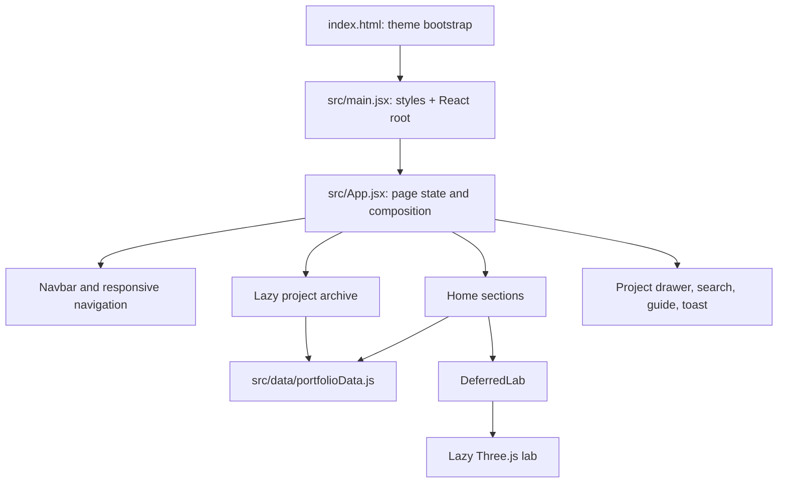

# Portfolio UI and architecture guide

This guide records how the portfolio is assembled and how to extend it without losing project context. It describes the implementation in this repository. If prose and code disagree, inspect the source files below and update this document with the change.

## Product and design intent

This is a personal engineering and computational research portfolio. Its main tasks are to introduce Dhrubo, show selected work, share career history and skills, explain services, and make contact easy. The science lab is a supporting demonstration.

The visual direction is a restrained glass studio: translucent surfaces reveal soft ambient color; thin edge highlights and blur create depth; typography and work remain the focus. Desktop uses a left section rail, centered page, and right action dock. Smaller screens use a top bar, four-item bottom bar, and full section menu. Avoid turning the page into a dense dashboard or applying strong glass to every nested element.

## Source of truth and CSS cascade

`AGENTS.md` is the maintained design contract: light canvas `#fdfdfc`, dark canvas `#0B0A0A`, light green `#15803d`, dark emerald `#22c55e`, glass surfaces, responsive behavior, and desktop dual rails.

`src/styles/theme.css` defines semantic tokens. `src/index.css` provides Tailwind and the original base and component CSS. `src/styles/refinement.css` and `src/styles/components.css` add primitives and responsive refinements. `src/styles/studio.css` provides later art direction for the hero, navigation, projects, dialogs, experience, and science lab. `src/styles/stack.css` owns the technical stack gallery. `src/main.jsx` imports these in that order, so later rules can override earlier rules. Search all stylesheets for a selector before changing it; there is legacy overlap. Prefer scoped rules in the owning component stylesheet over additional broad overrides.

`design-system/portfolio/MASTER.md` is a generated artifact from an earlier direction. Its palette and examples conflict with the maintained `AGENTS.md` and live tokens. Treat it as historical reference, not authority. Reconcile it before regenerating.

## Application structure

`index.html` applies the saved theme before React mounts to prevent a theme flash. `src/App.jsx` owns theme state and local storage, home/archive view state, hash navigation, selected project, search, guide, toast state, and the global `Ctrl/Cmd+J` shortcut. The archive and guide use `React.lazy`; the 3D lab is deferred until it is near the viewport.

### Home page order

1. `HeroBento` — introduction, portrait, location/availability, calls to action, capabilities, local time, and metrics.
2. `ProjectsShowcase` — featured case study, supporting cards, and archive link.
3. `Experience` — work, education, credentials, events, and photo preview.
4. `Skills` — logo-led technology gallery and expandable details.
5. `Strategy` — selectable engineering approach.
6. `DeferredLab` — placeholder, then interactive science lab.
7. `Services`, `Contact`, and `Footer`.

The archive is a separate hash-addressable view. The project drawer, search, and guide are dialogs; toast is transient feedback.

## Navigation and URL behavior

`src/components/navigation/navConfig.js` is the shared map of section IDs, labels, anchor URLs, and icons. Desktop sidebar, mobile menu, and mobile bottom bar consume it. The bottom bar intentionally includes only `hero`, `projects`, `experience`, and `contact`; the mobile menu exposes every destination. `Navbar.jsx` coordinates the responsive controls and `useActiveSection.js` tracks the current section. The right dock owns search, portfolio guide, GitHub, contact, and theme actions; keep navigation links on the left and utility actions on the right.

`#all-projects` selects the archive. Other section hashes navigate to the home view and scroll. Use `navigateToHome` or `navigateToAllProjects` in `App.jsx` so URL and view state remain coordinated.

## Content model

`src/data/portfolioData.js` is the structured source for `personalInfo`, `projectsData`, `skillsData`, `experienceData`, `educationData`, `certificationsData`, `eventsData`, `servicesData`, `engineeringStrategy`, and `automationScenarios`.

### Projects

Project records include stable `id`, `title`, `subtitle`, `category`, `categoryLabel`, `badge`, `featured`, `image`, `desc`, `longDesc`, `tech`, `highlights`, `url`, `githubUrl`, and `hasLiveDemo` fields. Put images in `public/projects/` and reference them with root-relative paths. `ProjectsShowcase.jsx` currently chooses selected work by explicit project IDs; change that list to change which projects appear there. The first selected project gets the lead case-study presentation. Its additional description and highlights are available through the native “Inside the build” disclosure, keeping the lead card compact. Only publish numerical outcomes when they are documented.

### Technical stack

`Skills.jsx` defines six presentation groups, logo names, and group order. The full descriptions and proficiency levels are in `skillsData`; details currently associate by array index. Keep group order aligned with `skillsData`, or migrate to explicit category keys before rearranging. Brand SVGs live in `public/tech/`; source and attribution are in `public/tech/README.md`, with license in `public/tech/LICENSE.txt`. Artwork comes from the Devicon collection. Preserve original logo art and colors. Use text for tools/methods that lack a correctly identified mark, such as ORCA, Gaussian, and Monte Carlo.

## Design tokens and responsive behavior

Use semantic values from `theme.css`: `--background`, `--foreground`, `--text-secondary`, `--primary`, `--primary-foreground`, `--glass-bg`, `--glass-border`, `--glass-highlight`, `--glass-shadow`, and the social/assistant/contact/code color variables. Green is the primary action; section icons use distinct vibrant accents against neutral labels. The dark canvas also has a faint square grid in `studio.css`.

A useful glass surface has a translucent fill, fine border, top-edge highlight, soft shadow, and restrained blur. The stack gallery and desktop/mobile navigation rails are clear examples. Keep inner content quieter than parent surfaces. Primary actions use a brighter emerald gradient with modest upper reflection, lower rim, and shallow pressed state; secondary actions use cooler cyan glass. Keep this dimensional treatment on key actions. Avoid heavy extrusion, strong glow on every icon, and opaque nested panels.

The desktop rails appear at `min-width: 1024px`; smaller screens use the mobile header and bottom bar. Sections may switch to one column at wider breakpoints. Fixed controls must respect safe-area insets and must not cover content. Reserve bottom navigation space, use at least 44px control targets where practical, maintain visible keyboard focus, and respect reduced-motion preferences.

## Interactions and accessibility

`src/components/ui/AccessibleDialog.jsx` wraps Radix Dialog with a title/description, focus containment, Escape handling, and focus restoration. Use it for dialogs. `ProjectDrawer.jsx` uses Radix Dialog directly and has its own focus restoration. Keep action elements as buttons/links rather than clickable `div`s. Search supports Up/Down/Enter/Escape and handles clipboard errors.

`AiChatModal.jsx` is a scripted portfolio guide, not a remote generative AI service. Its answers are hand-written keyword rules grounded in portfolio content. Visitor messages must remain text; do not render user input with `dangerouslySetInnerHTML`. Update the copy if the implementation’s capabilities change.

`Contact.jsx` prepares a `mailto:` draft; it does not send through a backend. The browser cannot confirm that a mail client opened or a message was sent. Describe the draft accurately and provide clipboard fallback when copying fails.

## Science lab and performance

`DeferredLab.jsx` observes a placeholder with a 400px root margin and loads `InteractiveMotionLab.jsx` near the viewport. The Three.js module builds the WebGL renderer, geometry, controls, observers, and animation loop, then disposes resources on cleanup. Its selector presents 3D, wave, and crystal studies. `ScienceStudies.jsx` implements wave interference and a projected cubic lattice with controls, pause/reset, visibility-aware animation, and reduced-motion default pause.

These are illustrative visualizations, not scientific solvers. Label what the visitor sees; do not present decorative animation as a verified DFT, molecular dynamics, or quantum result. The 3D code remains a sizeable separate download by design; the initial page can render without loading it.

## Assets and dependencies

Profile/project images and icons are static files under `public/`. Technology marks are local SVGs under `public/tech/`. `index.html` links Google Fonts and Font Awesome; React components also use Lucide. Runtime/build dependencies are listed in `package.json`: React 19, Vite 8, Tailwind 4, Radix primitives, Lucide, Three.js, and Oxlint. This is a client-rendered Vite site with no application backend.

## Change workflow

1. Read `AGENTS.md` and this guide, then inspect the relevant component and data.
2. For a new section, update `navConfig.js`, add the section in `App.jsx`, and decide whether it belongs in the mobile bottom bar.
3. For new facts, update `portfolioData.js` and the corresponding view; avoid duplicating facts in JSX.
4. For visual work, inspect all matching selectors because the stylesheets have legacy overlap. Update a semantic token or scoped component rule.
5. For dialogs, support keyboard use, Escape, and focus restoration. For motion, consider reduced motion, visibility, and cleanup.
6. Keep this guide and README current when architecture, data shape, URL behavior, or setup changes.
7. Run `npm run build` and `npm run lint`; inspect both themes at phone, tablet, and desktop widths after UI changes.

## Maintenance notes

- Theme switching is offered once per viewport: right dock on desktop, mobile top bar below 1024px. The left sidebar has no theme switch.
- `experience.css` owns the scoped Experience timeline, neutral glass cards, filters, and education/event refinements. Contributions remain expandable; filter counts derive from data.

- `ReactionLoader.jsx` and its adjacent CSS provide the decorative violet flask only for the science lab fallback. Archive and guide use text loading states. The lab's offscreen placeholder is static; animation runs only after loading is requested. Reduced motion disables waves and bubbles.
- `personalInfo.name` is the public display name, AR Dhrubo. `headline`, `heroIntro`, and `heroCapabilities` provide software-focused hero content. Experience defaults to Engineering; research and teaching remain available through filters.
- Action gradients live in `theme.css`. `studio.css` applies deep emerald primary actions, neutral headings, and section icon tiles that reuse navigation accents. Supporting archive actions use glass.

- `studio.css` is a later art-direction layer, not a full consolidation of the older stylesheets.
- The generated design-system master file is stale; `AGENTS.md` and `theme.css` are authoritative.
- `Skills.jsx` and `skillsData` currently rely on matching array order.
- Never run `git push` unless the user directly instructs it.
