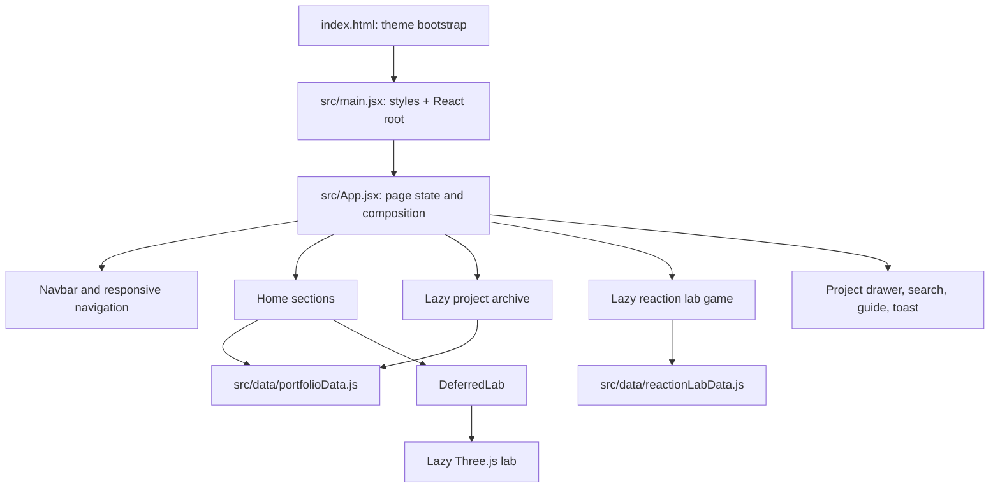

# Portfolio UI and architecture guide

This guide records how the portfolio is assembled and how to extend it without losing project context. It describes the implementation in this repository. If prose and code disagree, inspect the source files below and update this document with the change.

## Product and design intent

This is a personal engineering and computational research portfolio. Its main tasks are to introduce Dhrubo, show selected work, share career history and skills, explain services, and make contact easy. The science lab is a supporting demonstration.

The visual direction is a restrained glass studio: translucent surfaces reveal soft ambient color; thin edge highlights and blur create depth; typography and work remain the focus. Desktop uses a left section rail, centered page, and right action dock. Smaller screens use a top bar, four-item bottom bar, and full section menu. Avoid turning the page into a dense dashboard or applying strong glass to every nested element.

## Source of truth and CSS cascade

`AGENTS.md` is the maintained design contract: light canvas `#fdfdfc`, dark canvas `#0B0A0A`, light green `#15803d`, dark emerald `#22c55e`, glass surfaces, responsive behavior, and desktop dual rails.

`src/styles/theme.css` defines semantic tokens. `src/index.css` provides Tailwind and the original base and component CSS. `src/styles/refinement.css` and `src/styles/components.css` add primitives and responsive refinements. `src/styles/studio.css` provides later art direction for the hero, navigation, projects, dialogs, experience, and science lab. `src/styles/stack.css` owns the technical stack gallery. `src/main.jsx` imports these in that order, so later rules can override earlier rules. Search all stylesheets for a selector before changing it; there is legacy overlap. Prefer scoped rules in the owning component stylesheet over additional broad overrides.

`design-system/portfolio/MASTER.md` is a generated artifact from an earlier direction. Its palette and examples conflict with the maintained `AGENTS.md` and live tokens. Treat it as historical reference, not authority. Reconcile it before regenerating.

## Application structure

`index.html` applies the saved theme before React mounts to prevent a theme flash. `src/App.jsx` owns theme state and local storage, home/archive/reaction-lab/promo view state, hash navigation, selected project, search, guide, toast state, and the global `Ctrl/Cmd+J` shortcut. The archive, reaction lab, promo reel, and guide use `React.lazy`; the 3D lab is deferred until it is near the viewport.

### Home page order

1. `HeroBento` — single glass stage: availability/location pill ("Open to opportunities • Remote & Dhaka"), headline, intro, calls to action (including "Watch Reel" promo trigger), technology links, portrait with name chip and socials; metrics below.
2. `ProjectsShowcase` — 3 curated flagship cards in a compact equal grid (`brownsinterior`, `squicyuap`, `scrapeautomate`), with live links, drawer details triggers, and archive link.
3. `Experience` — work, education, credentials, events, and photo preview.
4. `Strategy` — "How I work" process showcase with four workflow illustrations (Design blueprint, Build page assembly, Automate branching pipeline, and Verify checklist). Single-stage interactive tabbed view on desktop (≥768px); sequential scroll revelation below 768px.
5. `DeferredLab` — placeholder, then interactive science lab (includes game teaser leading to `#reaction-lab`).
6. `Services`, `Contact`, and `Footer`.

The archive, reaction lab, and promo reel are separate hash-addressable views (`#all-projects`, `#reaction-lab`, `#promo`). The project drawer, search, and guide are dialogs; toast is transient feedback. Legacy `#skills` hash redirects directly to `#projects`.

## Navigation and URL behavior

`src/components/navigation/navConfig.js` is the shared map of section IDs, labels, anchor URLs, and icons. Desktop sidebar, mobile menu, and mobile bottom bar consume it. The bottom bar intentionally includes only `hero`, `projects`, `experience`, and `contact`; the mobile menu exposes every destination. `Navbar.jsx` coordinates the responsive controls and `useActiveSection.js` tracks the current section. The right dock owns search, portfolio guide, motion graphics promo reel trigger, GitHub, contact, and theme actions; keep navigation links on the left and utility actions on the right.

`#all-projects` selects the archive. `#reaction-lab` selects the interactive chemistry face reaction game. `#promo` selects the interactive motion graphics promo reel. Other section hashes navigate to the home view and scroll. Use `navigateToHome`, `navigateToAllProjects`, `navigateToReactionLab`, or `navigateToPromo` in `App.jsx` so URL and view state remain coordinated.

## Content model

`src/data/portfolioData.js` is the structured source for `personalInfo`, `projectsData`, `skillsData`, `experienceData`, `educationData`, `certificationsData`, `eventsData`, `servicesData`, `engineeringStrategy`, and `automationScenarios`.

### Projects

Project records include stable `id`, `title`, `subtitle`, `category`, `categoryLabel`, `badge`, `featured`, `image`, `desc`, `longDesc`, `tech`, `highlights`, `url`, `githubUrl`, and `hasLiveDemo` fields. Put images in `public/projects/` and reference them with root-relative paths. `ProjectsShowcase.jsx` displays 3 curated flagship cards in an equal grid with preview, category, title, concise description, up to 3 technology marks, live link, and a Details drawer trigger. `projects.css` owns framed previews and glass stack badges. Exact technology names map to local brand SVGs; unavailable marks keep text. Only publish documented numerical outcomes.

### Technical stack

Technology presentation is embedded directly in Hero, Projects, and Experience badges. `Skills.jsx` and `src/styles/stack.css` are unmounted legacy gallery assets retained in source. The structured skills data remains in `skillsData` for AI assistant grounding and search context. Brand SVGs live in `public/tech/`; source and attribution are in `public/tech/README.md`, with license in `public/tech/LICENSE.txt`. Artwork comes from the Devicon collection. Preserve original logo art and colors. Use text for tools/methods that lack a correctly identified mark, such as ORCA, Gaussian, and Monte Carlo.

## Design tokens and responsive behavior

Use semantic values from `theme.css`: `--background`, `--foreground`, `--text-secondary`, `--primary`, `--primary-foreground`, `--glass-bg`, `--glass-border`, `--glass-highlight`, `--glass-shadow`, and the social/assistant/contact/code color variables. Green is the primary action; section icons use distinct vibrant accents against neutral labels. `atmosphere.css` supplies visible dotted clouds, fine contours, and colored light behind the glass in both themes.

A useful glass surface has a translucent fill, fine border, top-edge highlight, soft shadow, and restrained blur. The stack gallery and desktop/mobile navigation rails are clear examples. Keep inner content quieter than parent surfaces. Primary actions use a brighter emerald gradient with modest upper reflection, lower rim, and shallow pressed state; secondary actions use cooler cyan glass. Keep this dimensional treatment on key actions. Avoid heavy extrusion, strong glow on every icon, and opaque nested panels.

The desktop rails appear at `min-width: 1024px`; smaller screens use the mobile header and bottom bar. Sections may switch to one column at wider breakpoints. Fixed controls must respect safe-area insets and must not cover content. Reserve bottom navigation space, use at least 44px control targets where practical, maintain visible keyboard focus, and respect reduced-motion preferences.

## Interactions and accessibility

`ui/Atmosphere.jsx` and `styles/atmosphere.css` own the fixed decorative background, replacing the legacy ambient blob markup. Existing semantic colors drive its emerald/cyan/lilac gradients, contours, and dot field. Fine hover pointers illuminate the dots and shift the background with frame-rate-independent easing; updates bypass React and requestAnimationFrame stops on settling, pointer exit, blur, hidden tabs, and cleanup. Live reduced-motion and pointer media queries disable tracking; touch devices retain static artwork. The layer is aria-hidden and never intercepts input.

`PromoReel.jsx` presents the finished 24-second MP4 using native video controls, a poster, English captions, and a text transcript. Playback starts on user action and pauses in hidden tabs. Escape returns to the portfolio with trigger focus restored. Two download links offer vertical 1080×1920 and widescreen 1920×1080 exports, both H.264 at 30 fps with no audio track. `scripts/render-promo.py` composes actual project screenshots, portfolio data, animated interface graphics, tool roles, and a visit-and-book call to action. Assets live in `public/media/`; reproduction notes are in `docs/PROMO-VIDEO.md`.

`brandLogoAssets` maps AI tools to exact publisher assets for Hero and Projects; Hermes uses its official PNG app icon. `public/tech/README.md` records origins and distinguishes publisher artwork from Devicon assets.

`src/components/ui/AccessibleDialog.jsx` wraps Radix Dialog with a title/description, focus containment, Escape handling, and focus restoration. Use it for dialogs. `ProjectDrawer.jsx` uses Radix Dialog directly and has its own focus restoration. Keep action elements as buttons/links rather than clickable `div`s. Search supports Up/Down/Enter/Escape and handles clipboard errors.

`AiChatModal.jsx` is a scripted portfolio guide, not a remote generative AI service. Its answers are hand-written keyword rules grounded in portfolio content. Visitor messages must remain text; do not render user input with `dangerouslySetInnerHTML`. Update the copy if the implementation’s capabilities change.

`Contact.jsx` prepares a `mailto:` draft; it does not send through a backend. The browser cannot confirm that a mail client opened or a message was sent. Describe the draft accurately and provide clipboard fallback when copying fails.

## Science lab and performance

`DeferredLab.jsx` observes a placeholder with a 400px root margin and loads `InteractiveMotionLab.jsx` near the viewport. The Three.js module builds the WebGL renderer, geometry, controls, observers, and animation loop, then disposes resources on cleanup. Its selector presents 3D, wave, and crystal studies. `ScienceStudies.jsx` implements wave interference and a projected cubic lattice with controls, pause/reset, visibility-aware animation, and reduced-motion default pause.

These are illustrative visualizations, not scientific solvers. Label what the visitor sees; do not present decorative animation as a verified DFT, molecular dynamics, or quantum result. The 3D code remains a sizeable separate download by design; the initial page can render without loading it.

## Assets and dependencies

Profile/project images and icons are static files under `public/`. Technology marks are local SVGs under `public/tech/`. `index.html` links Font Awesome; fonts are self-hosted via `src/styles/fonts.css`; React components use Lucide. Runtime/build dependencies are listed in `package.json`: React 19, Vite 8, Tailwind 4, Radix primitives, Lucide, Three.js, and Oxlint. This is a client-rendered Vite site with no application backend.

## Change workflow

1. Read `AGENTS.md` and this guide, then inspect the relevant component and data.
2. For a new section, update `navConfig.js`, add the section in `App.jsx`, and decide whether it belongs in the mobile bottom bar.
3. For new facts, update `portfolioData.js` and the corresponding view; avoid duplicating facts in JSX.
4. For visual work, inspect all matching selectors because the stylesheets have legacy overlap. Update a semantic token or scoped component rule.
5. For dialogs, support keyboard use, Escape, and focus restoration. For motion, consider reduced motion, visibility, and cleanup.
6. Keep this guide and README current when architecture, data shape, URL behavior, or setup changes.
7. Run `npm run build` and `npm run lint`; inspect both themes at phone, tablet, and desktop widths after UI changes.

## Maintenance notes

- `WorkflowScene.jsx` supplies four decorative workflow illustrations in Approach: blueprint, page assembly, branching automation, and verification checklist. All four steps appear in document order. An IntersectionObserver starts each finite illustration on entry; a frame-throttled scroll listener highlights the card nearest the viewport center. Buttons scroll directly to a step; reduced motion uses instant scrolling. The observer, scroll/resize listeners, and pending frame clean up on unmount. CSS entrance animations finish within 1.2 seconds, hover adds shallow depth, and reduced motion keeps artwork static. There are no animation timers or observers. A container query stacks the card when its content space is narrow. The former `ReactionScene.jsx` mixing illustration is no longer mounted.
- `typography.css` aligns section headings and reading widths. `theme.css` declares Space Grotesk headings, DM Sans body text, JetBrains Mono labels, and shared 1320px section width. `fonts.css` loads locally hosted files from `public/fonts/`, with licenses alongside them. Mobile hero places the introduction before the portrait.

- `hero.css` owns all hero styling (typography included; `typography.css` no longer overrides it). `.hero-shell` is a CSS container: at ≥720px container width the stage splits into copy + a 4:5 portrait with an overlaid glass name chip; narrower, the portrait becomes a compact profile row after the copy. Ambient color blobs sit behind the glass. Hero headline and intro copy live in `personalInfo`. The center column supports up to 1400px between the desktop rails.
- `Logo.jsx` renders a custom angular D with an emerald-to-teal face, offset extrusion, and fine edge highlights using theme colors; `logo.css` owns its glass tile and gradient colors. SVG gradient IDs are unique per instance. `public/brand/dhrubo-mark.svg` is the matching standalone dark mark and favicon. Existing social-preview and Apple touch images remain separate assets.

- `sidebar.css` owns the spacious, vertically centered desktop glass rail, with viewport-limited scrolling on short screens. Its shared width scales from 260–304px in `studio.css`, reserving matching content space. Search, guide, GitHub, contact, and theme utilities remain in the right dock; other social links remain in the profile/contact sections.
- `services.css` owns decorative glass service illustrations and reduced-motion-aware hover effects. Cards render `servicesData.shortTitle` and `summary`, with a contact link; detailed service data stays in the content model.
- Showcase stack rows display only exact local logos, with image alternatives and hover/focus labels. Technologies lacking local marks remain in the project drawer’s full stack.

- Theme switching is offered once per viewport: right dock on desktop, mobile top bar below 1024px. The left sidebar has no theme switch.
- `experience.css` owns the scoped Experience timeline, neutral glass cards, filters, and education/event refinements. Contributions remain expandable; filter counts derive from data.

- `ReactionLoader.jsx` and its adjacent CSS provide the decorative violet flask only for the science lab fallback. Archive and guide use text loading states. The lab's offscreen placeholder is static; animation runs only after loading is requested. Reduced motion disables waves and bubbles.
- `personalInfo.name` is the public display name, AR Dhrubo. `headline` and `heroIntro` position him as a Product Builder with a software engineering foundation. `heroTechnologies` maps labels to unchanged local Devicon SVGs, rendered as glass links to Skills. Experience defaults to Engineering; research and teaching remain available through filters.
- `contact.css` owns the Contact glass panel, profile, and native form controls. Topics select the email subject without replacing visitor text. The form prepares a mailto draft; extra social profiles use native disclosure. Clipboard feedback clears with a cleanup-safe timer.
- Action gradients live in `theme.css`. `studio.css` applies deep emerald primary actions, neutral headings, and section icon tiles that reuse navigation accents. Supporting archive actions use glass.

- `studio.css` is a later art-direction layer, not a full consolidation of the older stylesheets.
- The generated design-system master file is stale; `AGENTS.md` and `theme.css` are authoritative.
- `Skills.jsx` and `skillsData` currently rely on matching array order.
- Never run `git push` unless the user directly instructs it.

- Hero technology links use always-visible glass tiles with neutral, readable labels and original local brand artwork. The portrait name chip omits the decorative status dot; availability remains in the hero status pill.

Section introductions are centered and use names without numeric prefixes. Approach illustrations sit directly in the shared glass panel without a separate frame, caption bar, or counter.

The standalone Skills gallery is no longer mounted or linked in navigation/search/footer. Its source and data remain available for reuse. Hero technology links lead to Projects; legacy `#skills` bookmarks resolve to Projects.

Approach uses scroll-revealed cards below 768px and a single selectable panel on larger screens (hover, keyboard focus, or click). Project selection is limited to Brown’s Interior, Squicy UAP, and ScrapeAutomate in compact equal cards; remaining projects are available through All projects.

The reaction lab includes six guided challenges with hints, attempt-based scoring, explicit progression, replay, and free play. Discovery progress remains local. The shared D mark uses a curved, open cyan/lilac glass silhouette without a surrounding tile.

The reaction lab now opens in free experimentation mode in an illustrated 2D lab. Dr. Pip is an SVG scientist with expression and body reactions driven by outcomes; no portrait photos are used. Bottles support drag onto the flask or tap selection, followed by Run experiment. Guided challenges remain optional.

The lab play screen uses a single scientist speech prompt and bottle tray. Selecting the second bottle starts mixing automatically. Challenges, reaction explanations, and discoveries are collapsed optional sections. Reset clears the current experiment.

The public contact address is `info@ardhrubo.dev`, shared by the contact UI, resume XML, promo transcript, and rendered video. The promo contains no added project numbering or statistical claims.
